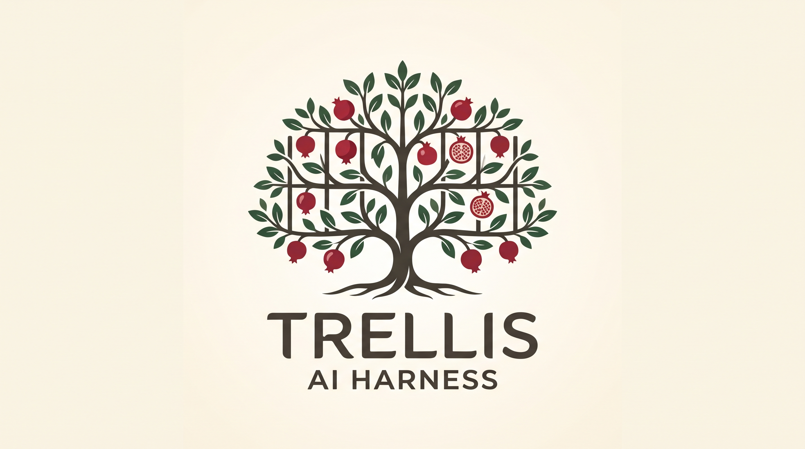

# Trellis Brand Guidelines

<p align="center">
  
</p>

---

## 1. Brand Identity & Narrative

### Core Concept

**Trellis** is an AI harness engineered to structure, support, and accelerate complex workflows. Where raw AI can be unruly or overbearing, Trellis provides an intentional architectural scaffold—guiding models and tools to bear meaningful weight without collapsing into chaos.

### The Metaphor: The Espaliered Pomegranate

* **The Espalier Grid:** Cultivated discipline, intentional structure, and modular constraints. It represents the harness itself—providing the rigid tiers necessary for upward and outward growth.
* **The Pomegranate Tree:** Vitality, dense internal structure, and abundant yield. A pomegranate carries hundreds of seeds within a firm, resilient rind, mirroring how Trellis organizes dense data, context, and capabilities into high-yield outcomes.
* **The Harmony:** Support without confinement. Growth with direction.

### Brand Voice & Persona

* **Grounded & Architectural:** Speaks with clarity, deliberate pacing, and structural certainty. Avoids generic tech buzzwords.
* **Cultivated, Not Artificial:** Modern software engineering meets patient craftsmanship.
* **Capable & Resilient:** Communicates strength, tensile reliability, and systematic rigor.

### Key Messaging & Taglines

* **Primary Tagline:** *Structure for intelligence.*
* **Secondary Taglines:**
  * *Cultivated scaffolding for complex systems.*
  * *Harness the model. Harvest the work.*
  * *Structured growth for autonomous workflows.*

---

## 2. Logo System & Usage

The Trellis visual mark balances organic growth and structured geometry through a stylized espaliered pomegranate tree woven along a clean wireframe lattice.

### Mark Components

1. **The Canopy & Lattice (Primary Icon):** A symmetrical espalier form whose branches trace perpendicular structural tiers, laden with stylized pomegranate fruit and foliage.
2. **The Wordmark:** **TRELLIS** set in a sturdy, geometric, high-contrast grotesque or humanistic sans-serif with wide tracking.
3. **The Sub-Mark / Descriptor:** `AI HARNESS` set in clean, uppercase grotesque lettering, optically centered below the wordmark.

### Logo Lockups

* **Primary Vertical Lockup:** Central icon above the wordmark and sub-mark, centered alignment.
* **Horizontal Lockup:** Icon placed on the left, with **TRELLIS** and the small-caps descriptor stacked to the right.
* **Standalone Icon / Favicon:** The espaliered canopy inside a rounded square or circle; used for CLI badges, repo avatars, and app icons.
* **Monochrome Mark:** A single-color high-contrast version (Deep Espresso or Crisp White) for command-line interfaces, terminal prompts, and single-ink printing.

### Clear Space & Minimum Sizing

* **Clear Space:** Maintain an exclusion perimeter equal to the height of the capital letter **“T”** in the wordmark around all sides of the logo.
* **Minimum Digital Size:**
  * Full lockup: 160 px wide.
  * Standalone icon: 24 × 24 px (simplified silhouette for micro-sizes).

---

## 3. Color Palette

The palette anchors organic botanical tones to a warm, premium parchment base, punctuated by a vivid pomegranate red for active states, alerts, and focal nodes.

| Role | Color Name | Hex Code | Purpose & Application |
| --- | --- | --- | --- |
| **Primary Base** | Linen / Warm Bone | `#F7F4EB` | Primary background canvas; editorial and terminal warm-light theme |
| **Primary Deep** | Espresso Trunk | `#262420` | Primary typography, borders, terminal dark mode background |
| **Brand Accent** | Pomegranate Crimson | `#A8202A` | Focal nodes, active execution status, CLI highlights, primary CTAs |
| **Structural Green** | Deep Laurel Green | `#2D4A3E` | Canopy foliage, success states, harness verification badges |
| **Neutral Mid** | Weathered Trellis | `#7D796F` | Secondary body copy, grid lines, passive harness scaffolds |
| **Surface Dark** | Basalt | `#181816` | IDE backgrounds, code blocks, dark-mode root layer |

---

## 4. Typography

### Primary Display / Wordmark Typeface

* **Font Choice:** **Space Grotesk** or **Plus Jakarta Sans**
* **Application:** Logo logotype, hero headers, marketing materials, landing pages.
* **Styling:** SemiBold / Bold, uppercase, letter-spacing `+0.08em` to `+0.12em`.

### Body & UI Typeface

* **Font Choice:** **Inter** or **Geist**
* **Application:** Documentation, web interfaces, settings panels, dashboard copy.
* **Styling:** Clean, neutral, high legibility across small UI labels and tabular data.

### Code & Terminal Typeface

* **Font Choice:** **JetBrains Mono** or **Fira Code**
* **Application:** CLI output, prompt templates, configuration manifests (`trellis.config.json`), API signatures.
* **Styling:** Regular / Medium, clear operator ligatures, distinct zero/oh forms.

---

## 5. UI, CLI & Visual Language

### The Grid Motif

* Subtly integrate faint perpendicular hairline guides (`0.5px` border in `#7D796F` at 20% opacity) into hero sections, documentation sidebars, and dashboard canvases.
* Visual representations of execution trees, agent DAGs (directed acyclic graphs), and prompt pipelines should resemble espalier branches—straight horizontal stems branching symmetrically from a central spine.

### Status Indicators

* **Idle / Scaffolding:** Laurel Slate (`#4A6B5D`)
* **Active Execution / Weaving:** Pomegranate Crimson pulse (`#A8202A`)
* **Success / Yield Verified:** Ripe Green (`#2D4A3E`)
* **Constraint Triggered / Pruned:** Burnt Umber (`#9E472A`)

### Terminal / CLI Branding

```text
  ┌─ trellis :: ai-harness v1.0.0
  │
  ├── [lattice] loading scaffold topology... ok
  ├── [root] binding model context... connected
  └── [yield] pipeline ready on port 9000
```

---

## 6. Brand Application Rules

* **Do:** Keep diagrams, architectures, and pipeline graphs organized along tidy horizontal and vertical axes to honor the espalier principle.
* **Do:** Use Pomegranate Crimson sparingly as an intentional pop of energy against the organic earth and parchment backdrop.
* **Don't:** Overload marketing materials with chaotic vines or wild foliage; the brand emphasizes deliberate pruning, structural containment, and intentional yield.
* **Don't:** Render the logo in neon, iridescent, or glowing synthwave gradients. Trellis belongs to the earth and the architecture that trains it.
