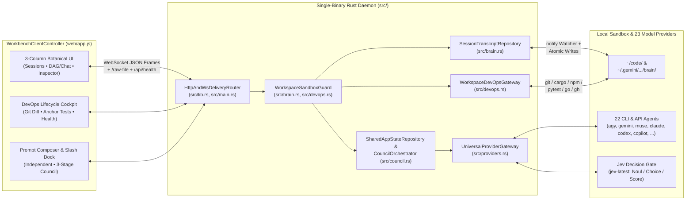

<p align="center">
  
</p>

<h1 align="center">TRELLIS :: AI HARNESS (<code>exo-suit</code>)</h1>

<p align="center">
  <em>Structure for intelligence. Cultivated scaffolding for complex autonomous workflows.</em>
</p>

<p align="center">
  
  
  
  
  
  <a href="./LICENSE"></a>
</p>

<p align="center">
  <a href="#overview"><strong>Overview</strong></a> •
  <a href="#key-capabilities"><strong>Capabilities</strong></a> •
  <a href="#system-architecture"><strong>Architecture</strong></a> •
  <a href="#multi-provider--3-stage-council-engine"><strong>Council &amp; Jev Gate</strong></a> •
  <a href="#developer-lifecycle-cockpit"><strong>DevOps Cockpit</strong></a> •
  <a href="#quickstart"><strong>Quickstart</strong></a> •
  <a href="#testing-suite"><strong>Testing</strong></a> •
  <a href="./GLOSSARY.md"><strong>Glossary</strong></a> •
  <a href="./AGENTS.md"><strong>Agent Guide</strong></a> •
  <a href="./BRAND_GUIDELINES.md"><strong>Brand Guidelines</strong></a>
</p>

---

## Overview

**Trellis (`exo-suit`)** is a single-binary Rust AI harness (`tokio` + `axum` + `notify` + `reqwest`) and zero-dependency HTML5 Canvas2D Progressive Web App engineered to structure, observe, and accelerate multi-model software engineering workflows across desktop and mobile.

Where raw autonomous agents can become opaque or unruly across multiple repositories, Trellis provides an intentional architectural scaffold—binding every session deterministically to its target workspace, visualizing live subagent and background task topologies on an orthogonal espalier DAG canvas, enforcing quantitative **System-1 Decision Gates**, and embedding a full **Developer Lifecycle Cockpit** (Git Diff, Anchor Test Gate, Slash-Command Pipeline, and Release Health Probes) directly in the workbench.

```text
  ┌─ trellis :: ai-harness v0.2.0 (exo-suit)
  │
  ├── [lattice] loading scaffold topology... ok
  ├── [root] binding model context (~/.gemini/antigravity-cli/brain)... connected
  ├── [cockpit] git + polyglot anchor test runner + health probes... armed
  └── [yield] pipeline ready on port 9000 (http://127.0.0.1:9000)
```

---

## Key Capabilities

### 1. Live Espalier DAG Canvas & Transcript Engine
- **Real-Time Telemetry (`notify` + WebSockets):** Watches live agent session transcripts (`transcript.jsonl`) and workspace directories (`~/code/<project>`) in real time with a sub-15 MB RAM footprint.
- **Active Subagent & Task Pruning:** Automatically prunes completed subagent branches into the parent agent's history while keeping actively executing subagents and running/daemon background tasks (`run_command`, dev servers, timers) visible as distinct capsule nodes on the DAG canvas.
- **Interactive Decision Cards (`ask_question`):** Renders structured single- and multi-select architectural questions directly in the chat stream and reconciles historical answers from transcript logs.

### 2. Bidirectional Workspace Isolation & Hard Cancellation
- **Deterministic `Session ↔ Project` Binding:** Every session persists its bound repository in `.session_project.txt` and resolves execution scope through a 4-tier priority chain (`Explicit Override` → `.session_project.txt` → `Transcript Path Inference` → `Active Project`).
- **Zero Cross-Session Bleed:** Concurrent background runs stream strictly into their originating session's message store (`session_custom_messages[session_id]`) and never bleed into other open chats.
- **Hard Execution Cancellation (`⏹ Stop`):** Every CLI subprocess and HTTP provider stream is wired to a `tokio::sync::watch` abort channel and `.kill_on_drop(true)` process guard, enabling instant mid-flight termination from the UI.

### 3. Topbar Session & Greenfield Project Provisioner (`+ New`)
- **Existing Workspace Project Sessions:** Spin up a clean, isolated session bound to any existing `~/code/<repo>` directory in one click.
- **Greenfield Project Scaffolding:** Provision a brand-new repository under `~/code/<slug>` with strict slug validation, automatic `git init -b main`, initial `README.md` scaffolding, and an optional Day-1 `/greenfield-architecture` kickoff prompt.

### 4. Developer Lifecycle Cockpit
- **Live Git Working Tree & Unified Diff Inspector:** Displays active branch, `ahead`/`behind` counts, staged/unstaged/untracked file badges, `+additions`/`-deletions` numstats, recent commit history, and a syntax-highlighted unified diff viewer.
- **1-Click Polyglot Anchor Test Gate (`▶ Run Tests`):** Auto-detects `Cargo.toml` (`cargo test`), `package.json` (`npm test`), `pyproject.toml`/`pytest.ini` (`pytest`), or `go.mod` (`go test ./...`), spawns a visible `TASK` node on the DAG canvas, and parses pass/fail counts.
- **Lifecycle Pipeline Dock & `/` Slash Autocomplete:** 1-click stage pills above the prompt composer for **1. Plan** (`/greenfield-architecture`), **2. Build** (`/tdd`), **3. Debug** (`/bushog`), **4. Review** (`/survey`), **5. Release** (`/prod`), **6. Monitor** (`/health`), and **7. Tidy** (`/tidy`).
- **Deploy & Health Readiness Probe:** Read-only probe of GitHub PR status, recent Actions CI runs (`gh`), and local `/api/health` endpoint latency.

---

## System Architecture



### Subsystem Directory & 5-Tier Seam Map

All modules follow the canonical vocabulary in [`GLOSSARY.md`](./GLOSSARY.md) and the 5-Tier seam architecture in [`docs/ARCHITECTURE.md`](./docs/ARCHITECTURE.md) and [`docs/specs/ARCHITECTURE-SPEC.md`](./docs/specs/ARCHITECTURE-SPEC.md):

| File | Canonical 5-Tier Seam | Responsibility |
| :--- | :--- | :--- |
| [`src/lib.rs`](./src/lib.rs) | **`HttpAndWsDeliveryRouter`** (Tier 1) | Library crate root exposing HTTP routes (`/`, `/api/health`, `/raw-file`, `/ws`), `generate_snapshot_json`, `dispatch_client_command`, and `spawn_brain_watcher`. |
| [`src/main.rs`](./src/main.rs) | **Binary Entrypoint** (Tier 1) | Initializes `SharedAppState`, binds `0.0.0.0:9000`, and launches the Axum server. |
| [`src/brain.rs`](./src/brain.rs) | **`WorkspaceSandboxGuard`** (Tier 2) & **`SessionTranscriptRepository`** (Tier 3) | Symlink-safe sandbox path guards, JSONL transcript parser, active subagent/task pruning, `ask_question` reconciliation, 19-directory skill scanner, and workspace/session provisioning. |
| [`src/council.rs`](./src/council.rs) | **`SharedAppStateRepository`** & **`CouncilOrchestrator`** (Tier 3) | Zero-bleed `Session` chat scoping, hard execution cancellation (`ActiveRunHandle`), independent prompt runner, and 3-Stage Borda `CouncilSession` engine. |
| [`src/providers.rs`](./src/providers.rs) | **`UniversalProviderGateway`** (Tier 4) | Table-driven 23-agent `Provider` registry, 7-dialect JSONL stream parser (`agy`, `muse`, `claude`, `gemini`, `codex`, `copilot`, `opencode`), headless CLI & HTTP API adapters, and NaN-safe `Jev Decision Gate` evaluation. |
| [`src/devops.rs`](./src/devops.rs) | **`WorkspaceDevOpsGateway`** (Tier 4) | `validate_workspace_sandbox`, Git status/porcelain/numstat parser, bounded unified diff generator, polyglot test runner auto-detector & executor, and TTL-cached CI/health readiness probes. |
| [`src/models.rs`](./src/models.rs) | **Domain Entity Contracts** (Pillar 1) | Serde data contracts for telemetry snapshots, `AgentNode`, `CouncilSession` ballots, `WorkspaceDevOpsSnapshot`, and `ClientCommand`. |
| [`web/`](./web/) | **`WorkbenchClientController`** (Tier 5) | Embedded zero-dependency HTML5 Canvas2D UI (`index.html`, `styles.css`, `app.js`, `manifest.json`). |

---

## Multi-Provider & 3-Stage Council Engine

Trellis orchestrates **23 coding agents and model providers** across two distinct cognitive classes, normalizing **7 JSONL streaming dialects** (`agy`, `muse` MSP v1, `claude`/`amp`/`cursor-agent`, `gemini`/`qwen`/`droid`, `codex`, `copilot`, and `opencode`) into real-time DAG telemetry nodes and scanning **15+ agent skill directories** (`~/.gemini/skills`, `~/.config/muse/skills`, `~/.claude/skills`, `~/.codex/skills`, `~/.copilot/skills`, `~/.cursor/skills`, `~/.config/opencode/skills`, `~/.config/goose/skills`, `~/.config/amp/skills`, `~/.factory/skills`, `~/.qwen/skills`, `~/.continue/skills`, `~/.cline/skills`, `~/.config/crush/skills`, `~/.agents/skills`):

| Agent / Provider | Category | Default Model | CLI / API Transport & Specialty |
| :--- | :--- | :--- | :--- |
| **Jev (`jev-latest`)** | `DECISION_SYSTEM_1` | `jev-latest` | Sub-200ms TypeSafe AI System-1 decision primitives (`Noul`, `Choice`, `Score`) with NaN-safe fail-closed fallback |
| **Antigravity (`agy`)** | Frontier CLI Agent | `gemini-4-argon` | `agy --output-format stream-json` • Multi-agent graph orchestration & deep repository execution |
| **Google Gemini CLI (`gemini`)** | Frontier CLI & API | `gemini-2.5-pro` | `gemini -p --output-format stream-json --approval-mode yolo` & Gemini OpenAI API • 1M-context multimodal reasoning |
| **Meta Muse Code (`muse`)** | Frontier CLI & API | `muse-spark-1.3` | `muse exec --json` (MSP v1) & Meta Model API (`api.meta.ai/v1`) • Worktree subagents & 1M-context reasoning |
| **Claude Code (`claude`)** | Frontier CLI & API | `claude-sonnet-4-6` | `claude -p --output-format stream-json` & Anthropic Messages API • Deep module boundaries & adversarial review |
| **OpenAI Codex (`codex`)** | Frontier CLI & API | `gpt-5.3-codex` | `codex exec --json --full-auto` & OpenAI API • Sandboxed execution & low-latency surgical patching |
| **GitHub Copilot (`copilot`)** | Frontier CLI & API | `claude-sonnet-4.5` | `copilot -p --output-format json --allow-all` & GitHub Models API • Repository & PR/Actions workflow integration |
| **Cursor Agent (`cursor`)** | Frontier CLI Agent | `claude-4.5-sonnet` | `cursor-agent -p --output-format stream-json --force` • Multi-file composer & semantic codebase indexing |
| **OpenCode (`opencode`)** | Open-Source CLI | `claude-sonnet-4-5` | `opencode run --format json` • LSP-guided terminal coding agent & 75+ provider router |
| **Aider (`aider`)** | Open-Source CLI | `claude-sonnet-4-6` | `aider --message --yes-always` • Tree-sitter repository map, Architect/Editor split & auto-commit |
| **Block Goose (`goose`)** | Open-Source CLI | `claude-sonnet-4-5` | `goose run --text --no-session` • Autonomous MCP extension orchestration & YAML recipes |
| **Charm Crush (`crush`)** | Open-Source CLI | `claude-sonnet-4-5` | `crush run --yolo --quiet` • Fast Go terminal coding harness with multi-provider LSP context |
| **Sourcegraph Amp (`amp`)** | Specialized CLI | `smart` | `amp -x --stream-json --dangerously-allow-all` • Deep code-graph context & parallel Oracle subagents |
| **Factory Droid (`droid`)** | Specialized CLI | `claude-opus-4-6` | `droid exec -o stream-json --auto high` • Enterprise autonomous engineering & CI/CD remediation |
| **Qwen Code (`qwen`)** | Specialized CLI & API | `qwen3-coder-plus` | `qwen -p --output-format stream-json --yolo` & DashScope API • Polyglot agentic coding |
| **Continue CLI (`continue`)** | Specialized CLI | `claude-sonnet-4-5` | `cn -p --allow * --silent` • Headless continuous AI checks & rule enforcement |
| **Cline CLI (`cline`)** | Specialized CLI | `claude-sonnet-4-5` | `cline --auto-approve true` • Dual-phase Plan/Act autonomous coding & MCP execution |
| **DeepSeek (`deepseek`)** | Model API | `deepseek-reasoner` | DeepSeek API (`api.deepseek.com`) • First-principles R1/V3.2 algorithmic reasoning |
| **Kimi / Moonshot (`kimi`)** | Model API | `kimi-k2.5` | Moonshot API (`api.moonshot.ai/v1`) • 256K-context cross-repository synthesis |
| **xAI Grok (`grok`)** | Model API | `grok-code-fast-1` | xAI API (`api.x.ai/v1`) • Real-time systems reasoning & low-latency agentic coding |
| **Mistral / Vibe (`mistral`)** | CLI & Model API | `codestral-latest` | `vibe -p --auto-approve` & Mistral API (`api.mistral.ai/v1`) •SWE-bench Devstral & Codestral FIM |
| **Local Ollama (`ollama`)** | Local Inference | `qwen2.5-coder:32b` | `ollama run` & Local HTTP (`127.0.0.1:11434/v1`) • Zero-telemetry air-gapped local coding models |
| **OpenRouter (`openrouter`)** | Unified Gateway | `anthropic/claude-sonnet-4.6` | OpenRouter API (`openrouter.ai/api/v1`) • Single-key routing across 300+ frontier & open-weight models |

See [`docs/research/coding-agents-ecosystem.md`](./docs/research/coding-agents-ecosystem.md) and [`docs/research/muse-cli.md`](./docs/research/muse-cli.md) for the full primary-source CLI flag matrix, JSONL wire schemas, and authentication architecture.

### Execution Modes

1. **⚡ Independent Mode:** Dispatch prompts directly to any individual provider (local CLI or HTTPS API) or run a sub-200ms **Jev System-1 Decision Gate** evaluation (`{noul, choice, score}`).
2. **🏛️ 3-Stage Council Mode:**
   - **Stage 1 — Parallel Proposals:** Selected System-2 Generative AIs draft independent architectural proposals concurrently while the **Jev System-1 Gate** scores each candidate on `Noul` (regression risk), `Choice` (gate action), and `Score` (rubric alignment).
   - **Stage 2 — Cross-Critique & Negotiation:** Peers inspect neighboring proposals, surface trade-offs, and synthesize revised drafts.
   - **Stage 3 — Ranked-Choice Borda Ballot + Jev Gate Bonus:** Every peer casts a 1st-choice (`3.0 pts`) and 2nd-choice (`1.5 pts`) ballot with **strict zero self-voting**, combined with Jev's quantitative rubric bonus to elect and synthesize the winning solution.

---

## Developer Lifecycle Cockpit

The topbar DevOps strip (`#topbar-devops-strip`) and collapsible Cockpit drawer (`#main-devops-overlay`) give operators immediate visibility and control over the bound repository:

- **Git Diff & Working Tree Tab (`🌿 Git`):** Inspect modified, staged, renamed, and untracked files with per-file `+additions`/`-deletions` badges and click any file to view its unified diff (`git diff HEAD` or synthesized untracked file diff).
- **Anchor Test Gate Tab (`🧪 Tests`):** Click `▶ Run Tests` to execute the workspace's test suite as a live `TASK` node on the agent graph and inspect the terminal output excerpt and pass/fail tally.
- **Deploy & Health Tab (`🚀 Health`):** Monitor open pull requests, recent GitHub Actions workflow conclusions, release readiness (`git.is_clean && behind == 0 && !ci_failing`), and `/api/health` endpoint probes.

---

## Quickstart

### Prerequisites

- **Rust Toolchain:** Rust `1.85+` (2021 Edition) via [`rustup`](https://rustup.rs/)
- **Git:** Standard `git` CLI for workspace status, diff inspection, and greenfield repository initialization

### Clone, Build & Run Release Binary

```bash
git clone https://github.com/mcmxciillan/trellis-harness.git
cd trellis-harness
./build.sh
./target/release/exo-suit
```

Open **`http://127.0.0.1:9000`** in any desktop or mobile browser. Because `web/` assets are compiled directly into the Rust binary via `include_str!` / `include_bytes!`, `./target/release/exo-suit` runs as a self-contained executable.

### Optional Provider Environment Variables

Trellis auto-detects installed local CLIs (`agy`, `muse`, `claude`, `codex`, `gh`) and also accepts API keys via environment variables or the in-app **🔑 Keys** modal (held strictly in process memory and never written to disk):

```bash
export JEV_API_KEY="..."        # TypeSafe AI Jev System-1 Gate (https://api.typesafe.ai/v1/evaluate)
export GEMINI_API_KEY="..."     # Google Gemini / Antigravity API
export META_API_KEY="..."       # Meta Muse Code / Meta Model API (https://api.meta.ai/v1)
export ANTHROPIC_API_KEY="..."  # Anthropic Claude API
export OPENAI_API_KEY="..."     # OpenAI / Codex API
export DEEPSEEK_API_KEY="..."   # DeepSeek API
export MOONSHOT_API_KEY="..."   # Kimi / Moonshot API
export GITHUB_TOKEN="..."       # GitHub Copilot API
```

---

## Testing Suite

Trellis includes a **43-test** Rust verification suite spanning in-module unit anchors and 5 black-box integration test binaries in [`tests/`](./tests/):

```bash
# Run the entire unit + integration test suite
cargo test
```

| Test Target | Command | Coverage |
| :--- | :--- | :--- |
| **Library Unit Anchors** | `cargo test --lib` | Core invariants across `brain`, `council`, and `devops` (`11 tests`) |
| **Seam 1 — Brain & Transcript** | `cargo test --test seam_1_brain_and_transcript` | ANSI stripping, `ask_question` parsing, sandbox file resolution, atomic writes, subagent pruning & task capsules (`7 tests`) |
| **Seam 2 — Provisioning & Scope** | `cargo test --test seam_2_provisioning_and_scope` | Slug validation, greenfield/existing repo provisioning, session renaming & `ExecutionScope` resolution (`3 tests`) |
| **Seam 3 — Council & Providers** | `cargo test --test seam_3_council_and_providers` | 23-agent `Provider` registry, 7 CLI JSONL dialects, `OnceLock` binary cache, NaN-safe `Jev Decision Gate`, 3-stage Borda no-self-voting & hard cancellation (`11 tests`) |
| **Seam 4 — DevOps Cockpit** | `cargo test --test seam_4_devops_cockpit` | Symlink-safe `WorkspaceSandboxGuard`, git porcelain/rename/numstat parsing, polyglot test detection & diff synthesis (`6 tests`) |
| **Seam 5 — HTTP & WS Server** | `cargo test --test seam_5_http_and_ws_server` | Live Axum HTTP asset/health routes, `/raw-file` traversal blocking, telemetry snapshot, typed `COMMAND_ERROR` envelopes & WS command dispatch (`5 tests`) |

---

## Security & Sandbox Guarantees

- **Strict Path Sandboxing:** All file reads (`OPEN_FILE`, `/raw-file`) and DevOps commands (`validate_workspace_sandbox`, `resolve_sandboxed_file_path`) canonicalize paths and verify they reside inside `$HOME/code/<project>` or `$HOME/.gemini/antigravity-cli/brain/<session>`, rejecting `..` traversal and arbitrary system paths with `404 NOT_FOUND`.
- **In-Memory API Keys:** API keys configured via environment variables or the `SET_API_KEYS` WebSocket command are stored only in `SharedAppState::api_keys` in RAM and are never serialized into telemetry snapshots or written to disk.
- **Subprocess Lifecycle Hygiene:** Every spawned CLI or test runner process uses `.kill_on_drop(true)` and bounded timeouts to prevent orphan background processes.

---

## Brand Palette

| Role | Color Name | Hex Code | Purpose |
| :--- | :--- | :--- | :--- |
| **Primary Base** | Linen / Warm Bone | `#F7F4EB` | Primary background canvas; editorial warm-light theme |
| **Primary Deep** | Espresso Trunk | `#262420` | Primary typography, structural borders, dark-mode trunk |
| **Brand Accent** | Pomegranate Crimson | `#A8202A` | Focal nodes, active execution status, primary CTAs |
| **Structural Green** | Deep Laurel Green | `#2D4A3E` | Canopy foliage, verified yield states, Jev System-1 badges |
| **Neutral Mid** | Weathered Trellis | `#7D796F` | Secondary copy, `0.5px` hairline lattice guides, passive scaffolds |
| **Surface Dark** | Basalt | `#181816` | IDE backgrounds, code blocks, dark-mode root layer |

See [`GLOSSARY.md`](./GLOSSARY.md) for the canonical project vocabulary, [`AGENTS.md`](./AGENTS.md) for agent context rules, [`docs/ARCHITECTURE.md`](./docs/ARCHITECTURE.md) and [`docs/specs/ARCHITECTURE-SPEC.md`](./docs/specs/ARCHITECTURE-SPEC.md) for the 5-Tier deep seam specifications, and [`BRAND_GUIDELINES.md`](./BRAND_GUIDELINES.md) for full logo lockup, typography, and visual language rules.

---

## License

Released under the [MIT License](./LICENSE).

