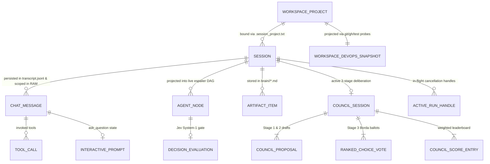
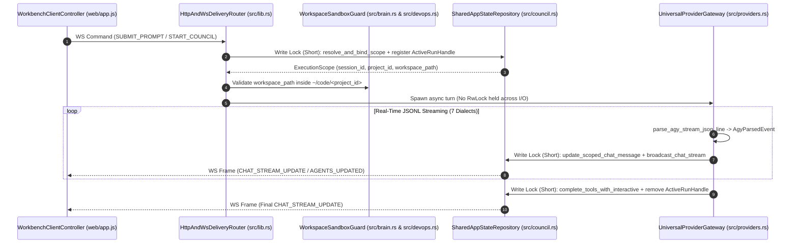

# Trellis (`exo-suit`) — Deep Architecture Reference

This document provides the deep architectural reference for **Trellis (`exo-suit`)**, complementing the executive overview in [`README.md`](../README.md), the canonical vocabulary in [`GLOSSARY.md`](../GLOSSARY.md), and the 5-Tier seam specifications in [`docs/specs/ARCHITECTURE-SPEC.md`](specs/ARCHITECTURE-SPEC.md).

---

## 1. Entity Relationship & Cardinality Model (Pillar 1)

---

## 2. 5-Tier Deep Seam Data Flow & Lock Discipline

---

## 3. Universal 7-Dialect JSONL Streaming Pipeline (`UniversalProviderGateway`)

[`parse_agy_stream_json_line`](../src/providers.rs) and [`parse_universal_cli_json_line`](../src/providers.rs) normalize seven distinct CLI JSONL wire protocols into [`CliStreamEvent`](../src/providers.rs) (`AgyParsedEvent`):

| Dialect Family | Producers | Session Init Event | Tool Start Event | Text Delta Event | Terminal Result Event |
| :--- | :--- | :--- | :--- | :--- | :--- |
| **1. Antigravity (`agy`)** | `agy` | `event: "init"` | `event: "step_update"` (`step_type: "tool"`, `state: "ACTIVE"`) | `event: "step_update"` (`step_type: "agent_response"`) | `event: "result"` |
| **2. Meta MSP v1 (`muse`)** | `muse exec --json` | `payload_type: "session.run.linked"` | `payload_type: "task.lifecycle.side_effect_intent"` | `payload_type: "run.output.delta"` | `payload_type: "run.terminal.completed"` + `"run.usage"` |
| **3. Anthropic Stream JSON** | `claude`, `amp`, `cursor-agent` | `type: "system"`, `subtype: "init"` | `type: "assistant"` (`content[].type: "tool_use"`) or `type: "tool_call"` | `type: "assistant"` (`content[].type: "text"`) | `type: "result"` |
| **4. Gemini Stream JSON** | `gemini`, `qwen`, `droid` | `type: "init"` | `type: "tool_use"` | `type: "message"` (`role: "assistant"`) | `type: "result"` |
| **5. OpenAI Codex JSONL** | `codex exec --json` | `type: "thread.started"` | `type: "item.started"` (`command_execution` / `file_change`) | `type: "item.completed"` (`agent_message`) | `type: "turn.completed"` |
| **6. GitHub Copilot JSONL** | `copilot -p --output-format json` | `type: "session.start"` | `type: "tool.execution_start"` | `type: "assistant.message"` | `type: "workflow.result"` |
| **7. OpenCode JSONL** | `opencode run --format json` | `type: "step_start"` | `type: "tool_use"` (`part.type: "tool"`) | `type: "text"` | `type: "step_finish"` |

Full CLI flags and authentication mechanics are documented in [`docs/research/coding-agents-ecosystem.md`](research/coding-agents-ecosystem.md) and [`docs/research/muse-cli.md`](research/muse-cli.md).

---

## 4. 3-Stage Borda Council & Jev System-1 Scoring Formula (`CouncilOrchestrator`)

In [`run_council_session`](../src/council.rs):
1. **Stage 1 (`STAGE_1_PROPOSALS`)**: All selected `GENERATIVE_SYSTEM_2` participants generate proposals in parallel while [`evaluate_jev_decision_gate`](../src/providers.rs) evaluates each proposal on `noul_risk_prob`, `choice_action`, and `score_rubric`.
2. **Stage 2 (`STAGE_2_NEGOTIATION`)**: Each participant critiques its neighbor's draft and produces a `revised_draft`.
3. **Stage 3 (`STAGE_3_VOTING`)**:
   - Each peer casts a `RankedChoiceVote` (`first_choice` = `3.0 * confidence` Borda points; `second_choice` = `1.5 * confidence` Borda points).
   - **Zero Self-Voting Enforcement**: Ballots where `first_choice == voter_provider` or `second_choice == voter_provider` are deterministically re-routed to the highest-ranked non-self peer.
   - **Jev Gate Bonus**: `jev_gate_bonus = (jev_rubric_score * 2.0) + ((1.0 - jev_noul_safety) * 1.5)`.
   - **Total Weighted Score**: `weighted_score = borda_points + jev_gate_bonus`.
