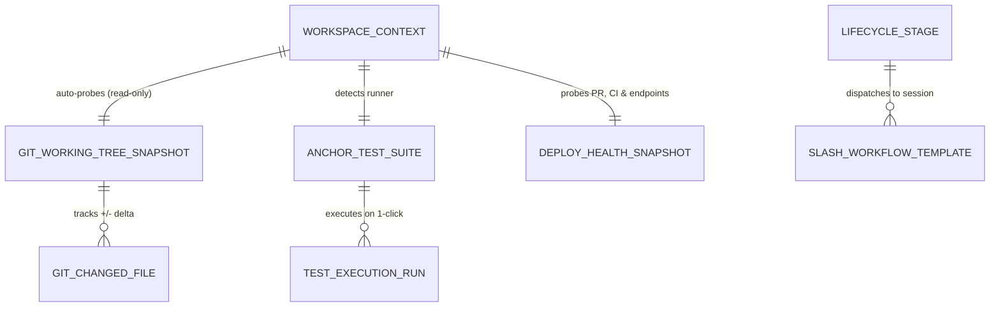

# Trellis AI Harness — Developer Lifecycle Cockpit & Engineering Workbench Architecture Specification

**Project**: `exo-suit` (Trellis AI Harness)  
**Architecture Paradigm**: Deep Modules & 5-Tier Seam Model (`PILLARS.md`)  
**Scope**: End-to-End Developer Throughput Cockpit (Plan → Develop → Test → Review → Deploy → Monitor)

---

## 1. Executive Summary & Architectural Vision

To maximize a programmer's throughput across the entire software engineering lifecycle without leaving the harness, Trellis introduces the **Developer Lifecycle Cockpit**:

1. **Live Git Working-Tree & Unified Diff Review Workbench (`src/devops.rs`)**:
   - Auto-refreshes read-only Git telemetry (`branch`, `ahead/behind`, `dirty_count`, per-file `+additions / -deletions`, staged/unstaged status, and recent commits) whenever the active workspace (`~/code/<project_id>`) switches or files change.
   - Renders a syntax-highlighted **Red/Green Unified & Split-Hunk Diff Viewer** on the Main Screen (`#main-devops-overlay`), with 1-click **Review Diff (`/code-review`)** and **Compile PR Audit (`/survey`)** agent dispatches.
2. **Deterministic Anchor Test & Quality Gate Runner (`src/devops.rs`)**:
   - Automatically detects the active workspace's test runner (`Cargo.toml` → `cargo test`, `package.json` → `npm test` / `pnpm test`, `pyproject.toml` → `pytest`, `go.mod` → `go test ./...`).
   - Executes on explicit 1-click trigger (`RUN_WORKSPACE_TESTS`), streaming live pass/fail status, duration, exit code, and stdout/stderr into the Cockpit and spawning a visible `node_kind: "task"` capsule on the Agent Graph while running.
   - When tests fail (`RED`), surfaces a 1-click **"🔧 Dispatch Agent to Fix Failing Tests"** button that injects the exact failing test output and file context into the active workspace session.
3. **Lifecycle Slash-Command & Pipeline Dock (`web/index.html`, `web/app.js`)**:
   - Provides a tactile **6-Stage Engineering Lifecycle Dock** (`📐 Plan` → `⚡ Develop` → `🧪 Test` → `🔍 Review` → `🚀 Deploy` → `🩺 Monitor`) and slash-command autocomplete/launcher (`/greenfield-architecture`, `/bushog`, `/tdd`, `/code-review`, `/survey`, `/prod`, `/tidy`, `/health`, `/database-hygiene`) directly in the composer and cockpit.
4. **Deployment, CI/CD & Service Health Telemetry Probe (`src/devops.rs`)**:
   - Performs non-blocking read-only probes of `gh pr status` / `gh run list --limit 3` (GitHub PR & CI pipeline status) and local/configured service health endpoints (`/api/health`, local dev ports), with 1-click `/prod` release preparation, `/health` runbook verification, and automated incident triage when a probe or CI workflow fails.

---

## 2. Pillar 1 & Pillar 6: Domain Entities, Cardinality & 5-Tier Deep Seam Map

### 5-Tier Deep Seam Architecture

| Tier | Architectural Layer | Module / File | Responsibility & Line Budget |
| :--- | :--- | :--- | :--- |
| **Tier 1** | **Thin Delivery Adapters** | `src/main.rs` (`handle_socket`) | `< 30 lines` per WS command (`REFRESH_DEVOPS`, `OPEN_GIT_DIFF`, `RUN_WORKSPACE_TESTS`, `PROBE_DEPLOY_HEALTH`). Zero shell/parsing logic in routes. |
| **Tier 2** | **Declarative Policy Guards** | `src/devops.rs` (`validate_workspace_sandbox`, `ExecutionPolicyGuard`) | Enforces read-only auto-refresh vs. explicit user-triggered test/deploy execution; guarantees all commands run strictly inside `~/code/<project_id>` with timeout bounds. |
| **Tier 3** | **Deep Domain Modules** | `src/devops.rs` (`WorkspaceDevOpsEngine`) | Encapsulates Git status/diff parsing, test framework auto-detection, red-to-green test ledger, and structured failure context synthesis. |
| **Tier 4** | **Anti-Corruption Gateways** | `src/devops.rs` (`GitCliGateway`, `TestRunnerGateway`, `GhAndHealthGateway`) | Subprocess gateways with `kill_on_drop(true)`, deterministic timeouts, and in-memory test fakes for Anchor unit testing. |
| **Tier 5** | **Headless State & View Projection** | `web/app.js` (`state.devops`, `renderDevOpsCockpit`, `renderTopbarDevOpsStrip`) | Reactive client store driving the compact Topbar DevOps Strip (`🌿 branch • ±files • 🧪 status • 🚀 CI`) and the full-window `#main-devops-overlay` Workbench. |
