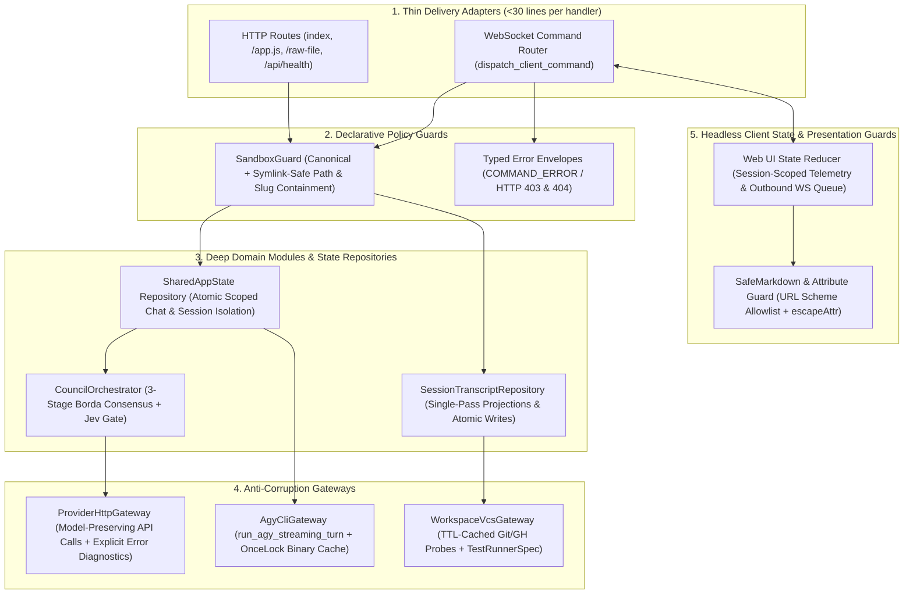

# System Architecture Specification: Trellis (`exo-suit`)

## 1. Executive Summary & 5-Tier Deep Seam Blueprint

**Trellis (`exo-suit`)** is a single-binary Rust AI Agent Harness & WebSocket/PWA Cockpit (`axum` + `tokio`) that orchestrates live Antigravity (`agy`) CLI streaming sessions, System-1 Jev Decision Gates, 3-stage Borda AI Council consensus, and workspace DevOps telemetry.

---

## 2. Core Entities & Cardinality (Pillar 1)
- **Workspace Project (`1`) ── (`N`) Session (`SessionSummary`)**: Each session binds to a canonical project directory under `~/code/<project_slug>` via `.session_project.txt`.
- **Session (`1`) ── (`N`) `ChatMessage` & (`N`) `AgentNode`**: Scoped per `session_id` with zero cross-session bleed; active runs (`ActiveRunHandle`) track child `node_ids` and `abort_tx` cancellation channels.
- **Session (`1`) ── (`0..1`) `CouncilSession`**: 3-stage Borda consensus (`STAGE_1_PROPOSALS -> STAGE_2_NEGOTIATION -> STAGE_3_VOTING -> COMPLETED | CANCELLED`) with `N` `CouncilProposal` items and `M` `RankedChoiceVote` ballots.

---

## 3. Architectural Modernization Specs (`/deforestation` DAG)

| Spec ID | Tier | Subsystem | Owned Files | Key Fixes |
| :--- | :--- | :--- | :--- | :--- |
| **[SPEC-01](SPEC-01-brain-and-sandbox-guard.md)** | Tier 1 | Brain & Sandbox Guard | `src/brain.rs`, `tests/seam_1_*.rs`, `tests/seam_2_*.rs` | Canonical symlink-safe `SandboxGuard`, atomic metadata writes, deduplicated `reconcile_interactive_prompt`, single-pass session projection, hermetic test roots (`EXO_BRAIN_DIR`). |
| **[SPEC-02](SPEC-02-provider-and-agy-gateway.md)** | Tier 1 | Provider & `agy` Gateway | `src/providers.rs`, `tests/seam_3_*.rs` | `OnceLock` binary cache (eliminates repeated `which` spawns), unified `run_agy_streaming_turn`, preserved model names, explicit HTTP/CLI error diagnostics. |
| **[SPEC-03](SPEC-03-devops-vcs-and-test-gateway.md)** | Tier 1 | DevOps VCS & Test Gateway | `src/devops.rs`, `tests/seam_4_*.rs` | Canonical symlink containment in `validate_workspace_sandbox`, 15s TTL cache on `gh` deploy probes, typed `TestRunnerSpec`. |
| **[SPEC-04](SPEC-04-shared-state-and-council-orchestrator.md)** | Tier 2 | `SharedAppState` & Council | `src/council.rs`, `src/models.rs` | Atomic `update_scoped_chat_message` (replaces 8 copy-pasted 3-vector loops), session-scoped `st.agents` guard, monotonic atomic IDs, delegates `agy` streaming to `SPEC-02`. |
| **[SPEC-05](SPEC-05-thin-delivery-and-ws-router.md)** | Tier 2 | Thin Delivery & WS Router | `src/lib.rs`, `src/main.rs`, `tests/seam_5_*.rs` | Decomposes 430-line `dispatch_client_command`, moves disk/git projections outside `RwLock`, emits `COMMAND_ERROR` envelopes, uses dynamic `st.server_port`. |
| **[SPEC-06](SPEC-06-frontend-store-and-xss-guards.md)** | Tier 3 | Web UI Store & XSS Guards | `web/app.js`, `web/index.html` | Outbound WS command queue during reconnects, unified `dispatchUserPrompt`, fixes `#quick-council-btn` null crash, session-scoped telemetry guard, `sanitizeHrefUrl` + `escapeAttr`. |
