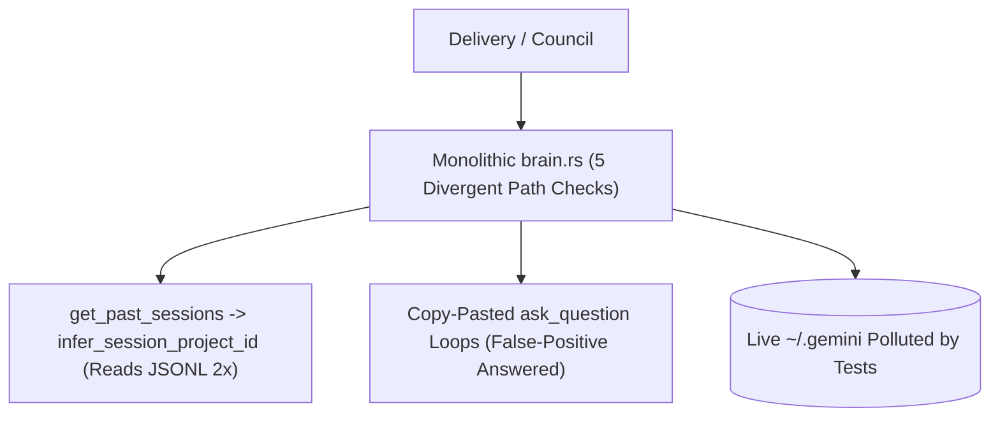
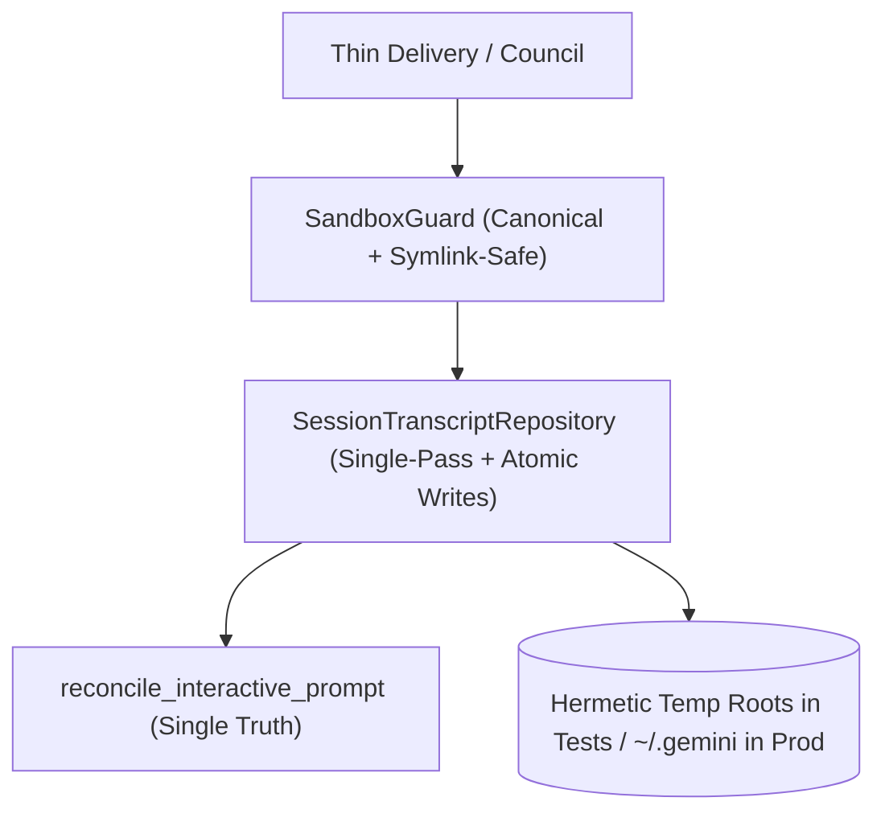

# Architectural Specification: SPEC-01 — Unified Sandbox Policy Guard & Brain Subsystem

## 1. Metadata & Execution Scope
- **Target Subsystem**: Workspace Sandbox Policy Guard, Session Transcript Repository & Brain Discovery (`src/brain.rs`)
- **Violated Pillars**:
  - **Pillar 2 (Invariants, Compliance & Lifecycle Transitions)**
  - **Pillar 4 (Authorization, Actors & Declarative Policy Guards)**
  - **Pillar 6 (Code Locality & Subsystem Barrels)**
  - **Pillar 7 (Query Projections, Performance & Caching)**
  - **Pillar 8 (Deterministic Anchor Truths & Quality Gates)**
- **DAG Tier & Dependencies**: `Tier 1` — Depends on: `None`
- **Owned Files (Exclusive Write Scope for Assigned Worker)**:
  - **Create / Deepen**: `src/brain.rs`, `tests/seam_1_brain_and_transcript.rs`, `tests/seam_2_provisioning_and_scope.rs`

---

## 2. Current State & Architectural Friction (Before)
- **Source Locations**:
  - `src/brain.rs:54-75` (`sanitize_code_path`) & `src/brain.rs:153-233` (`resolve_sandboxed_file_path`) — Divergent path sandboxing logic; `sanitize_code_path` falls back to `~/code` root when a path does not exist, while `save_session_project_id` (`L355-369`) only checks `!project_id.contains("..")` instead of calling `validate_project_slug`.
  - `src/brain.rs:411-505` (`get_past_sessions`) & `src/brain.rs:326-353` (`infer_session_project_id`) — `get_past_sessions` reads each session's `transcript.jsonl` to extract step counts and prompt previews, then calls `infer_session_project_id`, which re-reads the entire `transcript.jsonl` and `transcript_full.jsonl` a second time from disk.
  - `src/brain.rs:1252-1286` & `src/brain.rs:1545-1589` — Copy-pasted 35-line `ask_question` reconciliation loop in both `get_session_chat_thread` and `parse_session_node_recursive`, with a false-positive `let is_answered = !final_answers.is_empty() || has_subsequent_steps;` bug that marks pending questions as `"Answered"` even when `final_answers` is empty.
  - `src/brain.rs:2403-2484` (`save_session_agy_conversation_id`, `append_turn_to_session_transcript`) — Non-atomic file writes and unguarded transcript appending that can duplicate turns when `session_id == agy_conversation_id`.
  - `tests/seam_1_brain_and_transcript.rs:85-98` & `tests/seam_2_provisioning_and_scope.rs:113-116` — Integration tests write directly to the host's live `~/.gemini/antigravity-cli/brain` directory because `brain_dir()` / `code_root_dir()` do not support thread-local or environment overrides.
- **Smells Identified**:
  - [x] Copy-pasted imperative path/slug checks with inconsistent fail-closed rules
  - [x] State mutation bypassing atomic temp-file-and-rename persistence invariants
  - [x] Redundant N+1 full-file JSONL reads during session list projections
  - [x] Duplicated interactive question reconciliation logic with false-positive status bug
- **Before Diagram**:


---

## 3. Target Deep Seam & Interface Contract (After)
- **Public Interface Signature**:
```rust
// Declarative Sandbox Guard & Root Resolution
pub fn brain_dir() -> PathBuf; // Respects EXO_BRAIN_DIR override for hermetic testing
pub fn code_root_dir() -> PathBuf; // Respects EXO_CODE_ROOT override for hermetic testing
pub fn validate_project_slug(slug: &str) -> Result<String, String>;
pub fn resolve_sandboxed_workspace_path(project_slug: &str, rel_path: &str) -> Option<PathBuf>;

// Unified Interactive Question Reconciliation
pub fn reconcile_interactive_prompt(
    step_index: u32,
    questions: Vec<InteractiveQuestionItem>,
    subsequent_steps: &[serde_json::Value],
    saved_answers: &HashMap<String, Vec<String>>,
) -> InteractivePrompt;

// Idempotent, Atomic Session Transcript Persistence
pub fn atomic_write_string(path: &Path, content: &str) -> std::io::Result<()>;
pub fn append_turn_to_session_transcript(
    session_id: &str,
    prompt: &str,
    reply_text: &str,
    tool_calls: &[ToolCall],
    thinking: Option<&str>,
    tokens: &TokenMetrics,
);
```
- **Encapsulated Invariants**:
  1. **Fail-Closed Canonical Sandbox Guard**: `resolve_sandboxed_workspace_path` and `resolve_sandboxed_file_path` canonicalize both the root and target (or parent directory for new files) and reject any symlink escape, `..` traversal, or null byte. `save_session_project_id` enforces `validate_project_slug` before writing.
  2. **Atomic Metadata Persistence**: `.session_project.txt`, `.session_title.txt`, `.interactive_answers.json`, and `.agy_conversation_id.txt` are written via `atomic_write_string` (write to `.tmp` in the same directory and `fs::rename`).
  3. **Idempotent Transcript Appending**: `append_turn_to_session_transcript` checks if `load_session_agy_conversation_id(session_id).as_deref() == Some(session_id)` or if the last `PLANNER_RESPONSE` already matches `reply_text`, preventing duplicate entries when `agy` natively writes to the same session transcript.
  4. **Single-Pass Session Projection & Accurate Question Status**: `get_past_sessions` infers and caches `project_id` in the same pass without re-reading `transcript.jsonl`, and `reconcile_interactive_prompt` only marks a prompt `"Answered"` when non-empty answers exist or a subsequent `USER_INPUT` step was recorded.
- **After Diagram**:


---

## 4. Step-by-Step Implementation Plan
1. Add `EXO_BRAIN_DIR` and `EXO_CODE_ROOT` environment variable overrides to `brain_dir()` and `code_root_dir()`, plus `resolve_sandboxed_workspace_path` and `atomic_write_string` in `src/brain.rs`.
2. Enforce `validate_project_slug` inside `save_session_project_id` and `resolve_execution_scope`.
3. Extract `reconcile_interactive_prompt` and replace the duplicated 35-line blocks in `get_session_chat_thread` and `parse_session_node_recursive`, fixing the false-positive `is_answered` condition so a question without extracted answers is only marked `"Answered"` if a subsequent `USER_INPUT` step exists.
4. Optimize `get_past_sessions` to infer `project_id` during the initial scan and persist `.session_project.txt` once inferred.
5. Guard `append_turn_to_session_transcript` against duplicate turns when `agy` has already written to the same transcript.
6. Update `tests/seam_1_brain_and_transcript.rs` and `tests/seam_2_provisioning_and_scope.rs` to use isolated temp directories (`Drop` guard cleanup) and add unit/integration assertions for `reconcile_interactive_prompt`, atomic metadata writes, and symlink escape rejection.

---

## 5. Completion Criteria & Quality Gate
- [ ] `cargo test --lib --test seam_1_brain_and_transcript --test seam_2_provisioning_and_scope` passes (`GREEN`).
- [ ] Zero test directories created inside the live `~/.gemini/antigravity-cli/brain` during test runs.
- [ ] Zero duplicated `ask_question` reconciliation loops in `src/brain.rs`.
