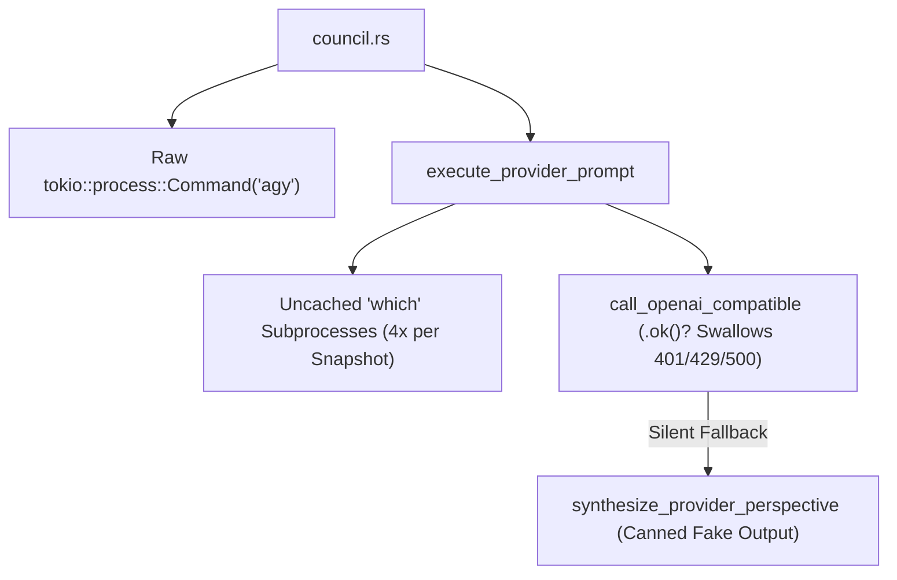
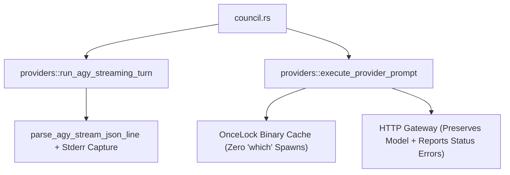

# Architectural Specification: SPEC-02 — Anti-Corruption Provider & `agy` CLI Streaming Gateway

## 1. Metadata & Execution Scope
- **Target Subsystem**: External LLM Provider Registry, HTTP Gateway & `agy` CLI Streaming Gateway (`src/providers.rs`)
- **Violated Pillars**:
  - **Pillar 2 (Invariants, Compliance & Lifecycle Transitions)**
  - **Pillar 3 (External Boundaries & Anti-Corruption Gateways)**
  - **Pillar 7 (Query Projections, Performance & Caching)**
  - **Pillar 8 (Deterministic Anchor Truths & Quality Gates)**
- **DAG Tier & Dependencies**: `Tier 1` — Depends on: `None`
- **Owned Files (Exclusive Write Scope for Assigned Worker)**:
  - **Create / Deepen**: `src/providers.rs`, `tests/seam_3_council_and_providers.rs`

---

## 2. Current State & Architectural Friction (Before)
- **Source Locations**:
  - `src/providers.rs:23-30` (`detect_binary`) — Spawns synchronous `std::process::Command::new("which")` up to 4 times on every `/api/health`, `TELEMETRY_SNAPSHOT`, and `SET_API_KEYS` call without caching.
  - `src/providers.rs:822-980` (`execute_provider_prompt`) & `src/providers.rs:1050-1078` (`call_openai_compatible`) — When a user configures a live API key (`LIVE_API`) and the upstream HTTP call returns `401`, `429`, `500`, or times out, `.ok()?` discards the error and silently falls through to `synthesize_provider_perspective` (`L1032-1153`), returning a fake template response as if the model answered.
  - `src/providers.rs:825-829`, `923`, `942`, `961` — Overwrites user-selected models (`claude-4-sonnet`, `claude-4-opus`, `gpt-5-codex`, `kimi-k2-5`) with hardcoded legacy strings (`"claude-3-7-sonnet-latest"`, `"gpt-4o"`, `"moonshot-v1-8k"`).
  - `src/council.rs:540-603` & `src/providers.rs:985-1018` — Raw `tokio::process::Command::new(&agy_bin)` CLI construction is split between `council.rs` and `providers.rs` instead of living behind a single gateway function in `src/providers.rs`.
- **Smells Identified**:
  - [x] Raw third-party CLI / HTTP calls without a unified Anti-Corruption Gateway
  - [x] Silent fallback to fake simulated text when a live API key or CLI call fails
  - [x] Uncached `which` subprocess spawning on every telemetry snapshot
  - [x] User-selected model identifiers overwritten with legacy hardcoded strings
- **Before Diagram**:


---

## 3. Target Deep Seam & Interface Contract (After)
- **Public Interface Signature**:
```rust
#[derive(Clone, Debug, PartialEq)]
pub enum AgyStreamOutcome {
    Completed {
        text: String,
        tokens: TokenMetrics,
        interactive_questions: Vec<InteractiveQuestionItem>,
    },
    Aborted,
    CliError(String),
}

pub async fn run_agy_streaming_turn<F>(
    agy_bin: &str,
    workspace_path: &std::path::Path,
    project_id: &str,
    provider_id: &str,
    model: &str,
    conversation_id: Option<&str>,
    prompt: &str,
    abort_rx: &mut tokio::sync::watch::Receiver<bool>,
    on_event: F,
) -> AgyStreamOutcome
where
    F: FnMut(AgyParsedEvent);
```
- **Encapsulated Invariants**:
  1. **Cached Binary Discovery**: `detect_binary` caches resolved binary paths in a ` std::sync::OnceLock<HashMap<String, Option<String>>>` so `build_provider_registry` performs zero `which` subprocess spawns after initial discovery.
  2. **Unified `agy` Streaming Gateway**: `run_agy_streaming_turn` in `src/providers.rs` encapsulates `tokio::process::Command::new(agy_bin)` in `workspace_path`, `--conversation`, `--model`, `--output-format stream-json`, `--print-timeout 300s`, stdout JSONL parsing via `parse_agy_stream_json_line`, and stderr capture on non-zero exit.
  3. **Model Fidelity & Explicit Error Reporting**: `resolve_api_model_name(provider_id, requested_model)` preserves valid caller models instead of clobbering them with `"claude-3-7-sonnet-latest"` or `"gpt-4o"`. When `has_api_key` is true (`LIVE_API`) and an upstream HTTP call fails, `execute_provider_prompt` surfaces a clear diagnostic message explaining the HTTP failure status rather than silently masquerading canned text as a live API response.
- **After Diagram**:


---

## 4. Step-by-Step Implementation Plan
1. Add `OnceLock` binary path caching to `detect_binary` in `src/providers.rs`.
2. Add `resolve_api_model_name(provider_id: &str, model: &str) -> String` in `src/providers.rs` so selected models are respected.
3. Implement `run_agy_streaming_turn` and `AgyStreamOutcome` in `src/providers.rs`, capturing both streamed stdout events and stderr diagnostics if the child exits non-zero with empty output.
4. Update `call_openai_compatible` and `execute_provider_prompt` so live API key errors return structured diagnostic details instead of silently pretending a canned template came from the live API.
5. Expand `tests/seam_3_council_and_providers.rs` with unit/integration tests for `resolve_api_model_name`, cached `detect_binary`, and `run_agy_streaming_turn` (using a mock shell script or echo command).

---

## 5. Completion Criteria & Quality Gate
- [ ] `cargo test --test seam_3_council_and_providers` passes (`GREEN`).
- [ ] `detect_binary` spawns `which` at most once per binary name across the process lifetime.
- [ ] `run_agy_streaming_turn` is deterministically tested in `tests/seam_3_council_and_providers.rs`.
