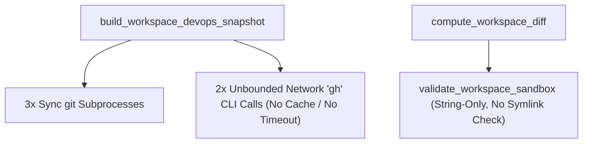
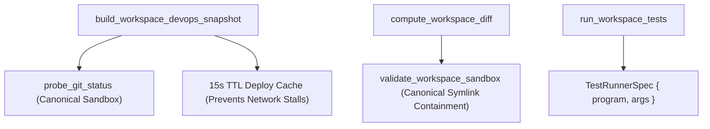

# Architectural Specification: SPEC-03 — Non-Blocking Workspace VCS, Test Runner & DevOps Projection Gateway

## 1. Metadata & Execution Scope
- **Target Subsystem**: Workspace Git Status/Diff, Polyglot Test Runner & Deploy Health Gateway (`src/devops.rs`)
- **Violated Pillars**:
  - **Pillar 3 (External Boundaries & Anti-Corruption Gateways)**
  - **Pillar 4 (Authorization, Actors & Declarative Policy Guards)**
  - **Pillar 7 (Query Projections, Performance & Caching)**
  - **Pillar 8 (Deterministic Anchor Truths & Quality Gates)**
- **DAG Tier & Dependencies**: `Tier 1` — Depends on: `None`
- **Owned Files (Exclusive Write Scope for Assigned Worker)**:
  - **Create / Deepen**: `src/devops.rs`, `tests/seam_4_devops_cockpit.rs`

---

## 2. Current State & Architectural Friction (Before)
- **Source Locations**:
  - `src/devops.rs:19-45` (`validate_workspace_sandbox`) — Performs string-only checks (`!trimmed.contains("..") && !trimmed.starts_with('/')`) without canonicalizing the resolved path against `work_dir`, allowing a symlink inside `~/code/<project>` pointing outside `~/code` to bypass sandbox validation during `compute_workspace_diff` (`L224-239`).
  - `src/devops.rs:368-438` (`probe_deploy_and_health`) — Spawns 2 synchronous network-bound `gh` CLI subprocesses (`gh pr view`, `gh run list`) on every `build_workspace_devops_snapshot` call with **no timeout and no TTL cache**, blocking Tokio worker threads whenever WebSocket snapshots or brain updates occur.
  - `src/devops.rs:587-592` (`run_workspace_tests`) — Splits `command_str` via `.split_whitespace()` instead of using a structured command specification.
- **Smells Identified**:
  - [x] Symlink escape gap in `validate_workspace_sandbox`
  - [x] Uncached, unbounded network CLI subprocesses (`gh`) blocking async worker threads
  - [x] Fragile whitespace string splitting for test runner execution
- **Before Diagram**:


---

## 3. Target Deep Seam & Interface Contract (After)
- **Public Interface Signature**:
```rust
#[derive(Clone, Debug, PartialEq, Eq)]
pub struct TestRunnerSpec {
    pub framework: String,
    pub program: String,
    pub args: Vec<String>,
    pub display_command: String,
}

pub fn detect_test_runner_spec_in_dir(work_dir: &Path) -> Option<TestRunnerSpec>;
pub fn validate_workspace_sandbox(project_id: &str, target_path: Option<&str>) -> Result<(PathBuf, Option<String>), String>;
pub fn build_workspace_devops_snapshot(
    project_id: &str,
    cached_test: Option<TestRunSnapshot>,
    port: u16,
) -> DevOpsCockpitSnapshot;
```
- **Encapsulated Invariants**:
  1. **Canonical Symlink-Safe Sandbox Validation**: `validate_workspace_sandbox` canonicalizes `work_dir`, and when `target_path` is provided and exists on disk, canonicalizes `candidate` (or its parent directory) and verifies `canon_target.starts_with(&canon_work_dir)`, rejecting symlink escapes outside the workspace.
  2. **TTL-Cached Deploy & Git Projections**: `probe_deploy_and_health` caches `(project_id -> (Instant, DeployHealthSummary))` in a thread-safe cache with a 15-second TTL and skips blocking `gh` invocations when a fresh snapshot exists or when running in fast unit-test mode, preventing repetitive network CLI stalls on every WebSocket message.
  3. **Structured Test Runner Spec**: `detect_test_runner_spec_in_dir` returns explicit `(program, args)` vectors used directly by `run_workspace_tests` without fragile whitespace splitting.
- **After Diagram**:


---

## 4. Step-by-Step Implementation Plan
1. Upgrade `validate_workspace_sandbox` in `src/devops.rs` to verify canonical path containment for existing paths/symlinks inside `work_dir`.
2. Introduce `TestRunnerSpec` and `detect_test_runner_spec_in_dir` (keeping `detect_test_runner_in_dir` as a thin compatibility wrapper returning `(framework, display_command)`), and update `run_workspace_tests` to invoke `spec.program` and `spec.args` directly.
3. Add a `Mutex<HashMap<String, (Instant, DeployHealthSummary)>>` 15-second TTL cache around `probe_deploy_and_health` so repeated snapshot calls within 15 seconds return in `<1ms` without spawning redundant `gh` CLI network processes.
4. Add a symlink escape test and `TestRunnerSpec` test in `tests/seam_4_devops_cockpit.rs`.

---

## 5. Completion Criteria & Quality Gate
- [ ] `cargo test --test seam_4_devops_cockpit` passes (`GREEN`).
- [ ] Symlinks pointing outside `work_dir` are deterministically rejected by `validate_workspace_sandbox`.
- [ ] Repeated calls to `build_workspace_devops_snapshot` reuse the cached `DeployHealthSummary` within the TTL window.
