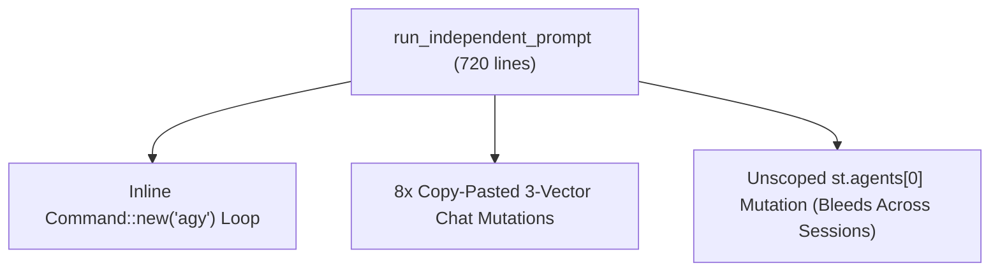
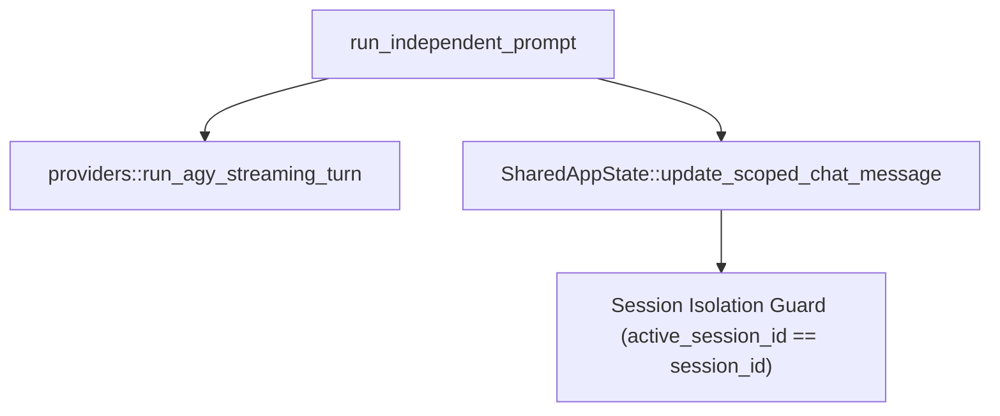

# Architectural Specification: SPEC-04 — Deep `SharedAppState` Repository & Scoped Council/Agent Orchestration

## 1. Metadata & Execution Scope
- **Target Subsystem**: Domain State Repository, Independent Agent Execution & 3-Stage AI Council (`src/council.rs`, `src/models.rs`)
- **Violated Pillars**:
  - **Pillar 1 (Domain Entities, Relationships & Cardinality)**
  - **Pillar 2 (Invariants, Compliance & Lifecycle Transitions)**
  - **Pillar 5 (Headless State Models & Pure Presentation)**
  - **Pillar 6 (Code Locality & Subsystem Barrels)**
- **DAG Tier & Dependencies**: `Tier 2` — Depends on: `SPEC-01`, `SPEC-02`, `SPEC-03`
- **Owned Files (Exclusive Write Scope for Assigned Worker)**:
  - **Create / Deepen**: `src/council.rs`, `src/models.rs`

---

## 2. Current State & Architectural Friction (Before)
- **Source Locations**:
  - `src/council.rs:126-162`, `206-241`, `659-695`, `722-751`, `810-830`, `940-966`, `1049-1069`, `1267-1305` — 8 separate copy-pasted blocks that manually mutate a chat message across `session_custom_messages`, `custom_chat_messages`, and `chat_thread`.
  - `src/council.rs:540-900` — 360 lines of inline `tokio::process::Command::new("agy")` spawning and stdout line-by-line parsing embedded directly inside `run_independent_prompt` instead of calling `providers::run_agy_streaming_turn`.
  - `src/council.rs:631-658`, `800-809`, `925-938`, `1609` — Background tasks mutate `st.agents` and `st.council` without checking `if scope.session_id == st.active_session_id`, allowing a background run in Session A to overwrite the root node and Council state while the user is viewing Session B.
  - `src/council.rs:334-338`, `1421` — Uses low-entropy wall-clock modulo (`d.as_millis() % 10000`) for `node_id` and `council_id`.
  - `src/council.rs:1415` — `let jev_enabled = participants.contains(&"jev".to_string()) || true;` has a hardcoded `|| true` tautology.
- **Smells Identified**:
  - [x] 8x copy-pasted 3-way chat vector mutation loops
  - [x] Raw CLI subprocess management embedded inside domain orchestration
  - [x] Cross-session state bleed on `st.agents` and `st.council` when background runs finish after session switch
  - [x] Low-entropy modulo ID generation and `|| true` tautology
- **Before Diagram**:


---

## 3. Target Deep Seam & Interface Contract (After)
- **Public Interface Signature**:
```rust
impl SharedAppState {
    pub fn bootstrap_from_disk(server_port: u16) -> Self;

    pub fn update_scoped_chat_message<F>(&mut self, session_id: &str, msg_id: &str, f: F) -> bool
    where
        F: Fn(&mut ChatMessage);

    pub fn switch_active_session(&mut self, session_id: &str) -> (String, Vec<AgentNode>, Vec<ChatMessage>);

    pub fn switch_active_project(&mut self, project_id: &str) -> Vec<AgentNode>;
}
```
- **Encapsulated Invariants**:
  1. **Single Atomic Chat Mutation Seam**: `SharedAppState::update_scoped_chat_message` updates `session_custom_messages[session_id]` and, if `self.active_session_id == session_id`, synchronizes `custom_chat_messages` and `chat_thread` in one place—eliminating all 8 duplicate loops.
  2. **Strict Session Isolation for Graph & Council**: `st.agents` mutations during `run_independent_prompt` and `run_council_session` are guarded by `if scope.session_id == st.active_session_id`. All outbound `CHAT_STREAM_UPDATE`, `AGENT_SPAWNED`, and `AGENTS_UPDATED` packets include `"session_id": scope.session_id`.
  3. **Gateway Delegation**: `run_independent_prompt` delegates `agy` CLI execution to `crate::providers::run_agy_streaming_turn`, shrinking `run_independent_prompt` by over 250 lines.
  4. **Monotonic Run Identifiers & Configurable Port**: `next_monotonic_run_id(prefix)` combines timestamp + `AtomicU64` counter for collision-free IDs, and `SharedAppState` stores `pub server_port: u16` (defaulting to `9000`).
- **After Diagram**:


---

## 4. Step-by-Step Implementation Plan
1. Add `pub server_port: u16` (with default `9000` in tests/constructors) and `SharedAppState::bootstrap_from_disk(server_port: u16)`, `update_scoped_chat_message`, `switch_active_session`, and `switch_active_project` to `SharedAppState` in `src/council.rs`.
2. Replace all 8 copy-pasted 3-vector chat mutation blocks in `src/council.rs` with `st.update_scoped_chat_message(...)`.
3. Refactor `run_independent_prompt` to call `crate::providers::run_agy_streaming_turn` and guard all `st.agents` mutations with `if scope.session_id == st.active_session_id`.
4. Replace modulo ID generation with an `AtomicU64` counter helper and remove the redundant `|| true` tautology in `run_council_session`.

---

## 5. Completion Criteria & Quality Gate
- [ ] All unit tests in `src/council.rs` and integration tests in `tests/seam_3_council_and_providers.rs` pass (`GREEN`).
- [ ] Zero raw `tokio::process::Command` invocations remain in `src/council.rs`.
- [ ] Zero duplicated 3-vector chat mutation loops remain in `src/council.rs`.
