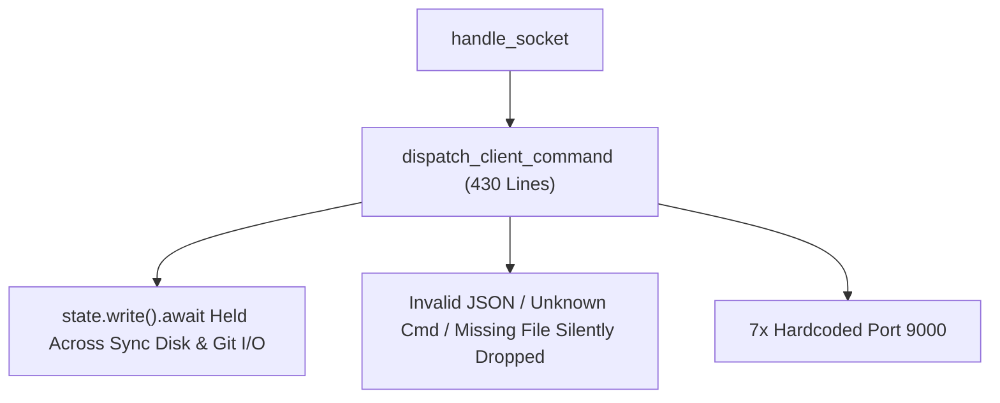
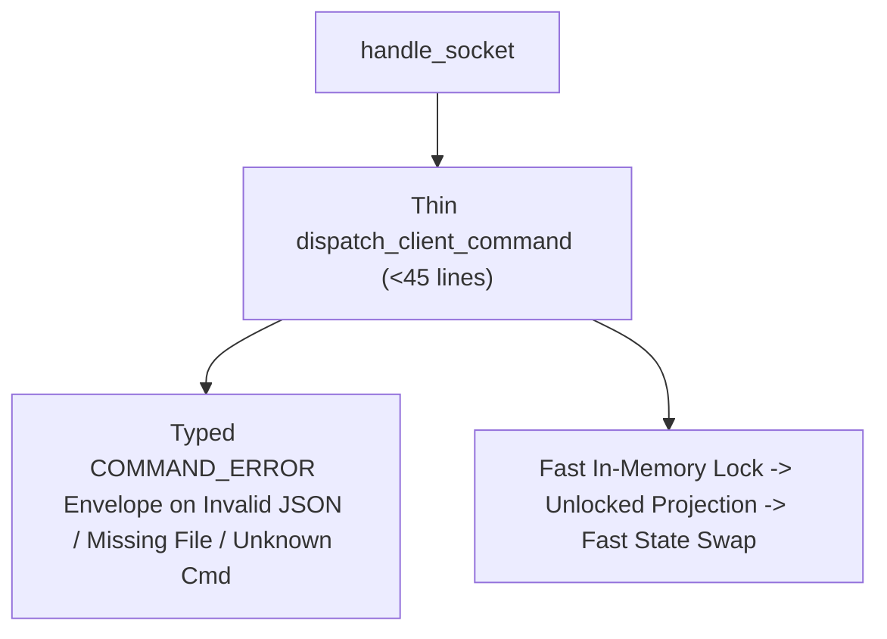

# Architectural Specification: SPEC-05 — Thin WebSocket/HTTP Delivery Router, Lock Hygiene & Typed Error Envelopes

## 1. Metadata & Execution Scope
- **Target Subsystem**: HTTP & WebSocket Delivery Layer, Command Router & Brain File Watcher (`src/lib.rs`, `src/main.rs`)
- **Violated Pillars**:
  - **Pillar 1 (Domain Entities, Relationships & Cardinality)**
  - **Pillar 2 (Invariants, Compliance & Lifecycle Transitions)**
  - **Pillar 4 (Authorization, Actors & Declarative Policy Guards)**
  - **Pillar 6 (Code Locality & Subsystem Barrels)**
  - **Pillar 7 (Query Projections, Performance & Caching)**
  - **Pillar 8 (Deterministic Anchor Truths & Quality Gates)**
- **DAG Tier & Dependencies**: `Tier 2` — Depends on: `SPEC-01`, `SPEC-02`, `SPEC-03`, `SPEC-04`
- **Owned Files (Exclusive Write Scope for Assigned Worker)**:
  - **Create / Deepen**: `src/lib.rs`, `src/main.rs`, `tests/seam_5_http_and_ws_server.rs`

---

## 2. Current State & Architectural Friction (Before)
- **Source Locations**:
  - `src/lib.rs:250-679` (`dispatch_client_command`) — 430-line monolithic `match` function that mixes command parsing, path splitting, multi-step `SharedAppState` write locks, blocking filesystem/git I/O under `RwLock`, and inline prompt string construction.
  - `src/lib.rs:255-257`, `319-327`, `677` — Malformed WebSocket JSON, unknown commands, and failed `OPEN_FILE` requests are silently dropped without sending a structured `COMMAND_ERROR` envelope on `direct_tx`.
  - `src/lib.rs:178-210`, `278-288`, `391-395`, `404-417`, `467-480`, `756-761` — Holds `state.read().await` or `state.write().await` while performing synchronous filesystem and subprocess I/O (`get_past_sessions`, `build_live_session_graph`, `build_workspace_devops_snapshot`).
  - `src/lib.rs:187`, `300`, `340`, `378`, `419`, `484`, `762` — Hardcodes literal port `9000` in 7 places instead of reading `st.server_port`.
  - `src/main.rs:15-36` — Inlines 25 lines of session discovery and `SharedAppState` field-by-field initialization.
- **Smells Identified**:
  - [x] Bloated delivery adapter (`dispatch_client_command` is 430 lines)
  - [x] Holding `RwLock` across synchronous disk/subprocess I/O
  - [x] Silent dropping of invalid JSON, unknown commands, and failed `OPEN_FILE` lookups
  - [x] Hardcoded port `9000` across delivery handlers
- **Before Diagram**:


---

## 3. Target Deep Seam & Interface Contract (After)
- **Public Interface Signature**:
```rust
// Structured Error Envelope sent on direct_tx
// { "type": "COMMAND_ERROR", "command": "<cmd>", "error": "<reason>" }
pub async fn dispatch_client_command(
    raw_txt: &str,
    ctx: &ServerContext,
    direct_tx: &tokio::sync::mpsc::UnboundedSender<String>,
);
```
- **Encapsulated Invariants**:
  1. **Zero Blocking I/O Under `RwLock`**: `generate_snapshot_json`, `handle_browse_dir`, `handle_set_project`, `handle_select_session`, `handle_create_session`, and `spawn_brain_watcher` clone only lightweight identifiers (`active_session_id`, `active_project`, `server_port`, `cached_test`) under a short lock, perform filesystem/git/devops projections outside the lock, and re-acquire a brief write lock only to swap in-memory vectors.
  2. **Deterministic Error Envelopes**:
     - Invalid JSON on WebSocket returns `{"type": "COMMAND_ERROR", "command": "PARSE_ERROR", "error": "..."}` on `direct_tx`.
     - Unknown `command` name returns `{"type": "COMMAND_ERROR", "command": "<name>", "error": "Unknown command"}` on `direct_tx`.
     - `OPEN_FILE` on an out-of-sandbox or missing path returns `{"type": "COMMAND_ERROR", "command": "OPEN_FILE", "error": "File not found or outside workspace sandbox"}` on `direct_tx`.
  3. **Thin Command Handlers & Dynamic Port**: `dispatch_client_command` delegates each command to a focused helper function using `st.server_port` instead of literal `9000`, and `src/main.rs` boots via `SharedAppState::bootstrap_from_disk(port)`.
- **After Diagram**:


---

## 4. Step-by-Step Implementation Plan
1. Refactor `generate_snapshot_json` in `src/lib.rs` to read `active_project`, `active_session_id`, `server_port`, `api_keys`, and `cached_test` under a brief read lock, then compute disk/devops projections outside the lock.
2. Decompose `dispatch_client_command` into focused per-command handlers (`handle_browse_dir`, `handle_open_file`, `handle_git_diff`, `handle_run_tests`, `handle_set_project`, `handle_select_session`, `handle_create_session`, `handle_answer_question`, `handle_approve_tool`, `handle_cancel_execution`), emitting `COMMAND_ERROR` envelopes on malformed JSON, failed `OPEN_FILE`, or unknown commands.
3. Update `spawn_brain_watcher` to track `(last_session_id, last_transcript_len)` so switching sessions does not falsely trigger a redundant watcher broadcast, and perform `build_live_session_graph` / `build_workspace_devops_snapshot` outside the `RwLock`.
4. Simplify `src/main.rs` to call `SharedAppState::bootstrap_from_disk(port)`.
5. Expand `tests/seam_5_http_and_ws_server.rs` with red-to-green anchor tests for malformed JSON, unknown commands, `OPEN_FILE` error envelopes, and dynamic port propagation.

---

## 5. Completion Criteria & Quality Gate
- [ ] `cargo test --test seam_5_http_and_ws_server` passes (`GREEN`).
- [ ] Zero `build_workspace_devops_snapshot` or `build_live_session_graph` calls occur while holding `state.write().await` or `state.read().await`.
- [ ] Zero hardcoded `9000` port literals remain in `src/lib.rs` handler calls.
