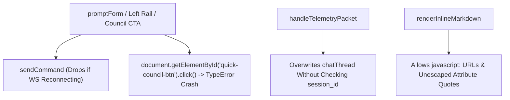
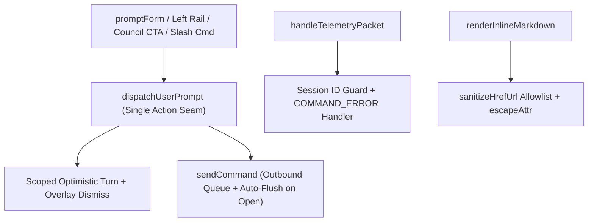

# Architectural Specification: SPEC-06 — Frontend State Reducer, Safe Markdown/Attribute Sanitization & Unified Prompt Dispatch

## 1. Metadata & Execution Scope
- **Target Subsystem**: Web UI Client, WebSocket Command Gateway, Markdown Sanitizer & Chat/Council Views (`web/app.js`, `web/index.html`)
- **Violated Pillars**:
  - **Pillar 2 (Invariants, Compliance & Lifecycle Transitions)**
  - **Pillar 3 (External Boundaries & Anti-Corruption Gateways)**
  - **Pillar 4 (Authorization, Actors & Declarative Policy Guards)**
  - **Pillar 5 (Headless State Models & Pure Presentation)**
  - **Pillar 7 (Query Projections, Performance & Caching)**
- **DAG Tier & Dependencies**: `Tier 3` — Depends on: `SPEC-04`, `SPEC-05`
- **Owned Files (Exclusive Write Scope for Assigned Worker)**:
  - **Create / Deepen**: `web/app.js`, `web/index.html`

---

## 2. Current State & Architectural Friction (Before)
- **Source Locations**:
  - `web/app.js:214-218` (`sendCommand`) & `web/app.js:1019-1049` (`promptForm` submit) — `sendCommand` silently drops payloads when `state.ws.readyState !== WebSocket.OPEN`. If the socket is reconnecting, submitting a prompt erases the user's input and pushes `opt-user-...`/`opt-reply-...` bubbles that stay stuck in `● ACTIVE` forever.
  - `web/app.js:2659-2661` (`renderCouncilTab`) — Clicking `#start-demo-council-drawer` calls `document.getElementById("quick-council-btn").click()`, throwing `TypeError: Cannot read properties of null (reading 'click')` because `#quick-council-btn` does not exist in `web/index.html`.
  - `web/app.js:1596-1605` (`renderAtelierLeftRail`) & `web/app.js:3173-3183` (`renderProvidersTab`) — Clicking a provider card sends a raw `SUBMIT_PROMPT` without `session_id`, `project_id`, or `pushOptimisticChatTurn`, so the user sees no chat feedback.
  - `web/app.js:293-439` (`handleTelemetryPacket`) — Does not check `pkt.session_id` / `pkt.active_session_id` on `CHAT_STREAM_UPDATE` or `AGENT_SPAWNED`, allowing background runs from another session to overwrite the active chat thread.
  - `web/app.js:1177-1214` (`renderInlineMarkdown`) & `1510, 1742, 1781, 1818, 3011, 3014, 3119` — Allows `javascript:` / `data:` URLs in markdown links and uses `escapeHtml` instead of `escapeAttr` inside double-quoted HTML attributes.
  - `web/app.js:444-449` & `3201-3204` — Attaches two duplicate `ResizeObserver` instances to `graphViewport`.
- **Smells Identified**:
  - [x] Silent command drop on WebSocket reconnect leaving orphaned optimistic chat turns
  - [x] Null-dereference crash (`#quick-council-btn`) in Council drawer CTA
  - [x] Unscoped telemetry packet handling across session switches
  - [x] Missing URL scheme allowlist (`javascript:` XSS vector) and unescaped `"` in attributes
  - [x] Duplicate `ResizeObserver` registrations
- **Before Diagram**:


---

## 3. Target Deep Seam & Interface Contract (After)
- **Public Interface Signature**:
```javascript
// 1. Resilient WebSocket Gateway with Outbound Queue
function sendCommand(payload); // Enqueues while CONNECTING/reconnecting & flushes on open

// 2. Unified Prompt & Council Dispatch Action
function dispatchUserPrompt({ promptText, isCouncil, provider, model });

// 3. Safe URL & Attribute Sanitization Guards
function sanitizeHrefUrl(rawUrl); // Allowlists http:, https:, file:, conversation:, #, /
function escapeAttr(str); // Escapes &, <, >, ", '
```
- **Encapsulated Invariants**:
  1. **Guaranteed Outbound Command Delivery**: `sendCommand(payload)` sends immediately when `state.ws.readyState === WebSocket.OPEN`, or pushes the serialized command onto a bounded `state.pendingOutboundQueue` (flushed automatically on `ws.addEventListener("open")`) and triggers an immediate reconnect if closed—never silently dropping user prompts.
  2. **Unified Prompt Action (`dispatchUserPrompt`)**: Used by `promptForm`, `#start-demo-council-drawer`, `renderAtelierLeftRail`, `renderProvidersTab`, and `triggerLifecycleWorkflow` so every prompt/council trigger consistently sets mode, pushes the optimistic chat turn, closes blocking overlays, switches to the Chat tab, and sends `session_id` + `project_id`.
  3. **Session-Scoped Telemetry Guard & `COMMAND_ERROR` Handling**: `handleTelemetryPacket` ignores `CHAT_STREAM_UPDATE` / `AGENT_SPAWNED` packets destined for a different `session_id`, and surfaces `COMMAND_ERROR` packets cleanly in the UI.
  4. **XSS-Safe Markdown & Attribute Escaping**: `sanitizeHrefUrl` blocks `javascript:`, `vbscript:`, and `data:` links in `renderInlineMarkdown`, and all `data-*` attributes use `escapeAttr`.
- **After Diagram**:


---

## 4. Step-by-Step Implementation Plan
1. Add `state.pendingOutboundQueue = []` and update `connectWebSocket` / `sendCommand` in `web/app.js` to queue commands when the socket is not yet `OPEN` and flush them on `open`.
2. Implement `dispatchUserPrompt({ promptText, isCouncil, provider, model })` and wire it into `promptForm`, `#start-demo-council-drawer` (fixing the `#quick-council-btn` null crash), `renderAtelierLeftRail`, `renderProvidersTab`, and `triggerLifecycleWorkflow`.
3. Update `handleTelemetryPacket` to guard `CHAT_STREAM_UPDATE` and `AGENT_SPAWNED` by `pkt.session_id || pkt.active_session_id` and handle `pkt.type === "COMMAND_ERROR"`.
4. Add `sanitizeHrefUrl` in `renderInlineMarkdown` to reject `javascript:`/`data:` URLs, replace `escapeHtml` with `escapeAttr` in all double-quoted HTML attributes, and remove the duplicate `ResizeObserver` at line 444.
5. Bump the script version query string in `web/index.html`.

---

## 5. Completion Criteria & Quality Gate
- [ ] Zero references to non-existent DOM IDs (`#quick-council-btn`) that can throw `TypeError`.
- [ ] `renderInlineMarkdown` neutralizes `[click](javascript:alert(1))` links.
- [ ] Submitting a prompt, clicking a provider in the left rail, or launching a Council session from the Council drawer immediately updates the Chat Inspector and prompts the backend.
